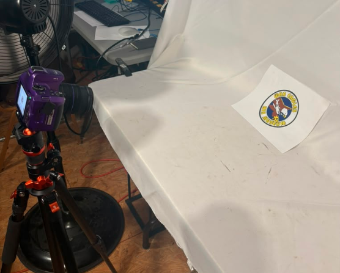
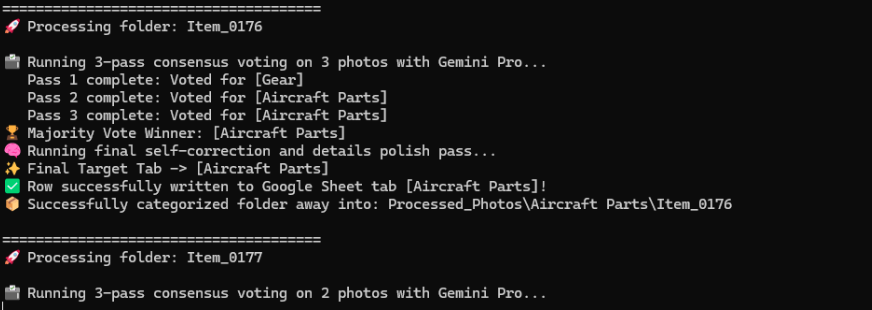
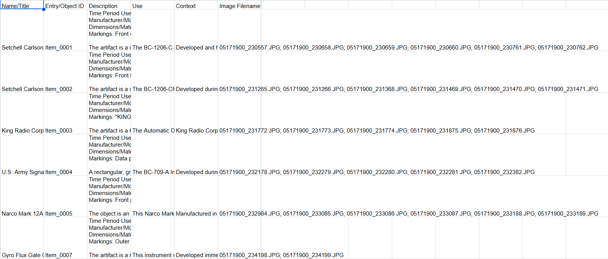

# WEAM Autonomous Artifact Digitization Pipeline ✈️📸

An automated, edge-to-cloud computer vision pipeline designed to replace manual archival data entry. Engineered for the War Eagles Air Museum (WEAM), this script systematically ingests, clusters, and classifies disorganized artifact photos, exporting structured catalog data directly into Google Workspace.

## 🚀 Performance Metrics
* **Throughput:** Fully automated ingestion, extraction, and database writing for **500+ historical artifacts weekly**.
* **Accuracy:** Maintained a **98% categorization accuracy rate** using a custom 3-pass LLM consensus loop and self-correction schema.
* **Architecture:** 30-stage, edge-to-cloud automated workflow utilizing the Google Gemini API and Google Sheets API.

---

## 🏗️ System Architecture

The pipeline divides tasks between a local ingestion client and cloud-based AI architectures across four core phases:

### Phase I: Local Ingestion & Visual Clustering
1. Scans camera SD directories for raw artifact imagery.
2. Compresses images to ultra-lightweight thumbnails (400x400px) to optimize API latency.
3. Performs a zero-shot multimodal clustering inference (`gemini-3.5-flash`) to group matching artifacts based on visual continuity.
4. Generates sequential `Item_XXXX` staging directories and transfers clusters locally.
5. Performs safe SD card wipes of verified assets.

### Phase II: Human-in-the-Loop Quality Gate
* Pipeline suspends execution to allow the operator to visually cross-reference auto-generated computer folders against physical Manila shipping tags. 
* Pressing `[ENTER]` unpauses the engine for deep analysis.

### Phase III: Deep Archival Analysis & Consensus Engine
To mitigate Large Multimodal Model (LMM) hallucination variance on obscure historical artifacts, the system utilizes a **3-Pass Consensus Voting** loop (`gemini-3.1-pro-preview`):
* Forces the model to evaluate the high-res dataset three separate times independently.
* Aggregates predicted categories into a list (e.g., `["Gear", "Uniforms", "Gear"]`).
* Uses Python's `collections.Counter().most_common(1)` to declare a majority winner.
* Executes a final self-critique validation pass to enforce JSON metadata labels and structural schema.

### Phase IV: Cloud ETL & File Lifecycle
* Authenticates to Google Workspace via OAuth2.
* Appends a structured 6-column relational row mapping narrative data and original image filenames to the corresponding Google Sheets tab.
* Moves local staging folders into the permanent archive directory.
---

## 📸 System in Action

### 1. Physical Ingestion & Staging
Custom photo booth setup utilizing standardized Manila identification tags and WEAM circular separator cards to establish boundaries for out-of-order camera rolls.



### 2. Multimodal Consensus & Self-Correction Engine
Real-time terminal execution demonstrating the 3-pass consensus voting loop resolving categorization variance (`Pass 1: Gear` vs `Pass 2/3: Aircraft Parts`) followed by an automated self-correction schema pass.



### 3. Automated Relational Cloud Export
Structured 6-column catalog entry automatically routed and committed to the matching Google Sheets category tab, appending normalized avionics descriptions, operational context, and asset image filenames.


---

## 📂 Data Schema & Directory Structure

```text
📦 WEAM_Archive
 ┣ 📂 Incoming_Photos (Staged clusters awaiting review)
 ┣ 📂 Processed_Photos (Completed, archived local assets)
 ┣ 📂 src
 ┃ ┗ 📜 pipeline.py
 ┣ 📜 .env
 ┗ 📜 credentials.json
```

---

## 🛠️ Setup & Execution

### Prerequisites
1. Python 3.9+
2. A valid Google Cloud OAuth2 Desktop Client `credentials.json` placed in the root directory.

### Installation
```bash
git clone https://github.com/yourusername/WEAM-Artifact-Pipeline.git
cd WEAM-Artifact-Pipeline
pip install -r requirements.txt
```

### Environment Configuration
Copy the `.env.example` file to a new file named `.env` and configure your API key and paths:
```env
GEMINI_API_KEY="your_api_key_here"
CAMERA_DCIM_DIR="D:\DCIM"
```

### Run the Pipeline
```bash
python src/pipeline.py
```
